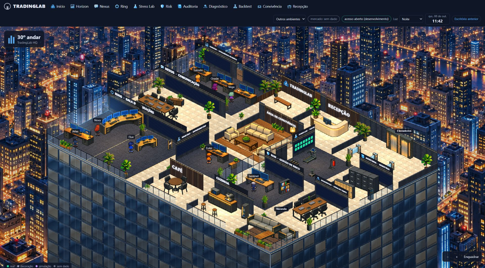
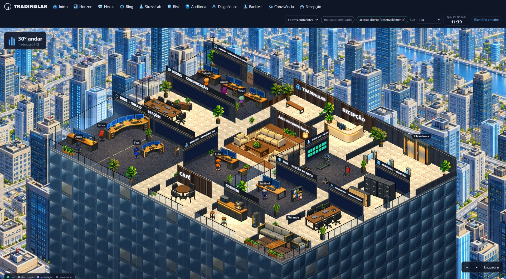
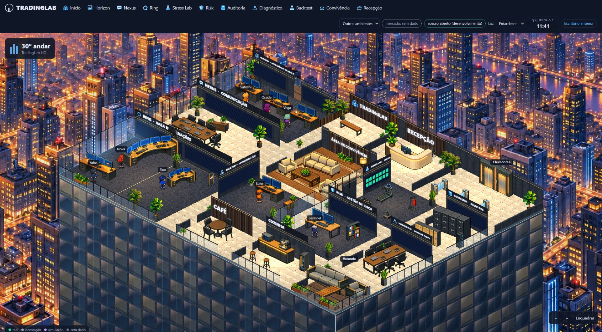
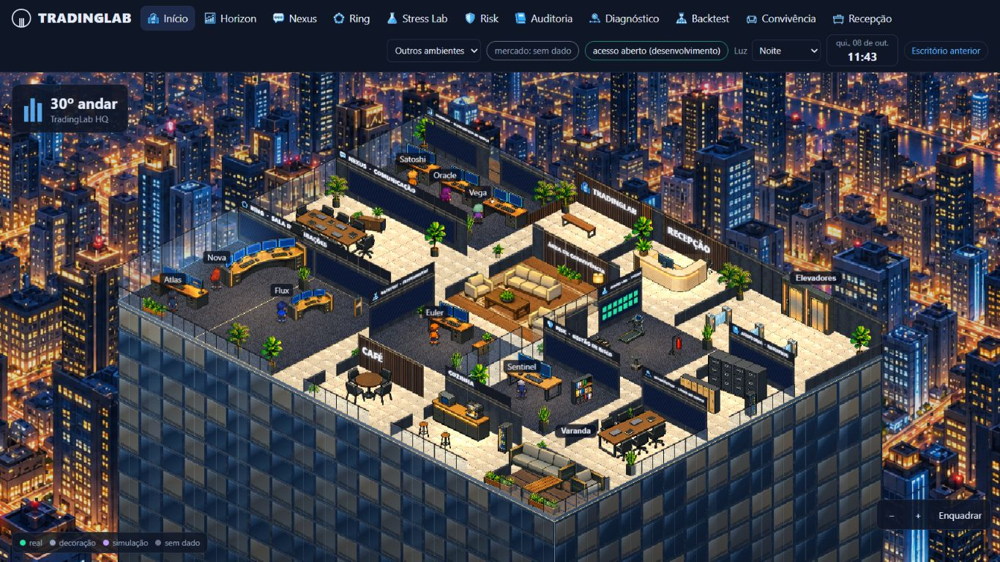
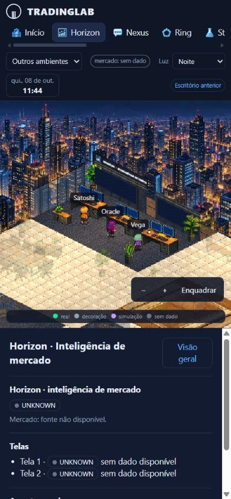
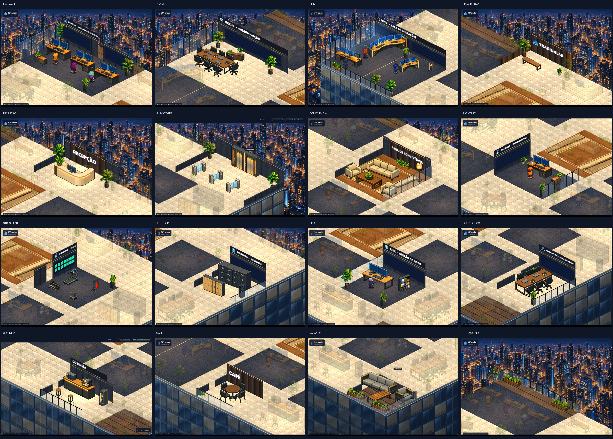

# Escritório 2.0 · arte e revisão do ambiente (F7)

Revisão da integração F7 sobre `feat/escritorio-2-f6`, guiada pela [referência aprovada](references/tradinglab-office-2-approved-reference.jpg). Horizon, Nexus e Ring ficam à esquerda; hall, recepção e elevadores ao fundo; convivência no centro; áreas técnicas à direita; café, cozinha e varanda junto à fachada.

## Planta e mobiliário

A grade foi ampliada de 32×24 para **40×30 tiles**, com cena de 1920×1056 unidades. Permanecem os **16 ambientes e os 12 identificadores de módulos**, incluindo os dois setores do Ring. Há **78 peças no mapa**, mais as oito cadeiras dos postos desenhadas separadamente. O espaço adicional permite corredores, acessos e conjuntos separados de móveis.

`art/apoios.json` mede os contatos inferiores das 46 silhuetas. Escala uniforme e posição usam esses apoios para conter os pés na ocupação declarada, com margem de 0,18 tile; o espelhamento segue a mesma regra. O tapete é recortado no polígono do piso e permanece andável. Nexus, Diagnóstico e Café usam as cadeiras integradas das mesas, sem duplicação.

Portas removem também o trecho da parede vizinha na mesma borda. Telas e placas respeitam as aberturas; Backtest e Stress Lab usam a parede i0, liberando o centro. Placas são pintadas no plano da parede, incluindo a marca do hall. Ao focar uma sala, paredes de outras áreas somem e sua mobília fica atenuada, permitindo conferir o ambiente e acessar seu painel.

## Arte, fachada e iluminação

A integração mantém **46 recortes de móveis/plantas, 35 ícones PNG, seis texturas e oito personagens com 12 poses**. Personagens usam folhas de 1152×512 e células de 192×256, com pés alinhados. Folhas antigas permanecem como reserva durante carregamento ou erro. Convivência e Recepção ganharam ícones SVG locais na barra.

A fachada foi reconstruída no desenho da cena: painéis de vidro azul, montantes, lajes, reflexos da cidade, salas inferiores iluminadas e contorno quente do andar. Sua altura acompanha o enquadramento e o afastamento máximo, evitando a faixa vazia no celular.

Foram gerados **cidade-dia.png** e **cidade-entardecer.png**, PNGs opacos de 1536×1024. A cidade noturna foi o alvo de edição e a imagem aprovada, referência de estilo. Os arquivos estão em `public/office2/art/` e em `C:\Users\Danrley\Downloads\office2-arte-gpt\`. [Prompts completos e origem](OFFICE_2_F7_ILUMINACAO_PROMPTS.md).

O ciclo usa os horários e a preferência do primeiro escritório: dia das 7h às 17h; entardecer/amanhecer das 17h às 19h e das 5h às 7h; noite nos demais horários. O seletor permite Automática, Dia, Entardecer ou Noite. Cidade e fachada mudam juntas, com transição de 850 ms; a preferência sobrevive ao recarregamento. O carregamento tardio das texturas preserva a fase atual.

## Navegação, vida e funções

A visão geral enquadra o andar inteiro. O foco considera paredes e espaço do painel. Há botões para aproximar, afastar e reenquadrar, além de arrastar e usar a roda do mouse. A barra tem 11 destinos principais e um seletor com os demais ambientes. No celular, os destinos principais rolam dentro da própria barra.

Passeios dos personagens em pausa, reflexos, brilho e movimento ambiente são decorativos. A apresentação pausa com a aba oculta e respeita redução de movimento. O ciclo visual não altera trabalho, preços, decisões ou resultados.

Módulos, rotas de leitura e fontes existentes permanecem. Fontes indisponíveis continuam UNKNOWN, com indicação explícita. Nenhum mercado, P&L, operação ou trabalho de agente foi fabricado. **Escritório anterior** mantém acesso aos painéis e ferramentas da primeira interface, cujo código não foi alterado nesta revisão.

## Reprodução

Os 31 PNGs originais fornecidos pelo usuário permanecem em Downloads. O repositório contém recortes normalizados, texturas e fundos utilizados.

```powershell
node --import tsx scripts/assets/arte-gemini.ts C:\Users\Danrley\Downloads\office2-arte-gpt public/office2/art --config=scripts/assets/arte-gpt.json
node --import tsx scripts/assets/texturas-gpt.ts C:\Users\Danrley\Downloads\office2-arte-gpt
node --import tsx scripts/assets/personagens-gpt.ts C:\Users\Danrley\Downloads\office2-arte-gpt
node scripts/assets/office2-layout.mjs
node --import tsx scripts/assets/office2-calibration.ts
```

O autor da planta valida limites, ocupações, portas, postos e rotas A* antes de gravar. A geração dos dois fundos está documentada à parte e não é repetida pelos scripts.

## Conferência e validação

- **Suíte completa:** 441 testes, **440 aprovados**, zero falhas e um ignorado, com `node --import tsx --test --test-concurrency=2 test/**/*.test.ts`.
- Após o último ajuste da reserva de personagens: **25 testes direcionados aprovados**, zero falhas, cobrindo mapa, F7 e regressões desta revisão.
- TypeScript sem erros; sintaxe de todos os scripts do Escritório 2.0 validada.
- Novas regressões verificam apoios de móveis espelhados, câmeras com painel no desktop/celular, portas compartilhadas, foco, horários e preferência, carregamento assíncrono das texturas, extensão da fachada no celular, ícones e rotas dos três fundos.
- Conferidos os **16 ambientes**, três iluminações, em 1920×1080, 1366×768 e 390×844. Foco, retorno e zoom conferidos no celular. Página de 390 px sem transbordamento horizontal; 11 destinos com ícone, sem imagens quebradas; console sem erros ou avisos.

Capturas usam a prévia local com estados iniciais do registro de agentes, sem snapshots privados. A conferência cobre composição e estados exercitados; não substitui a validação das fontes de produção em sessão autenticada.













Entrega no PR #100, sem merge ou deploy automático.
