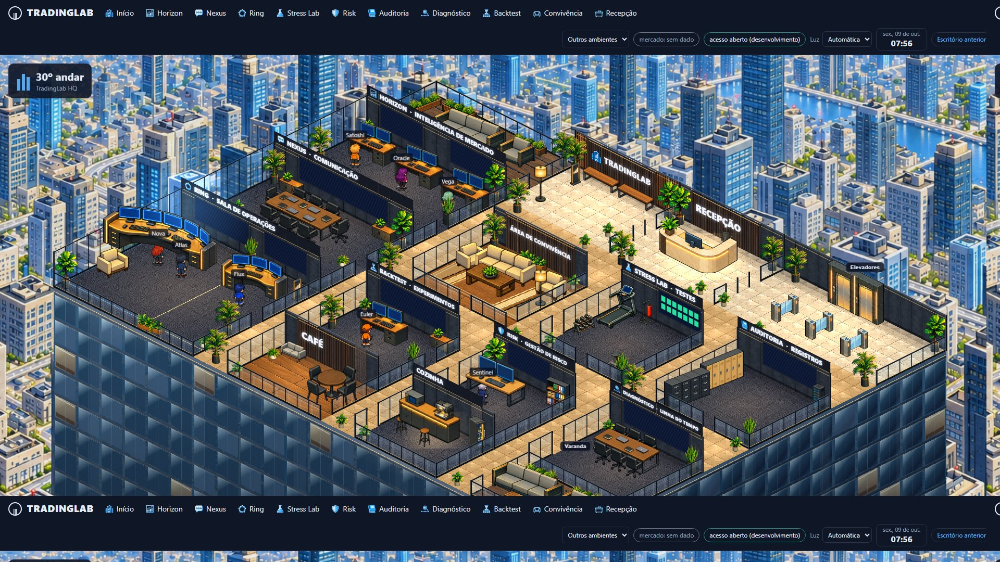
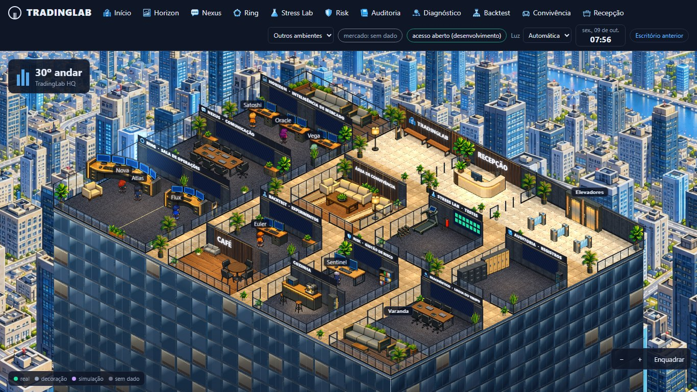
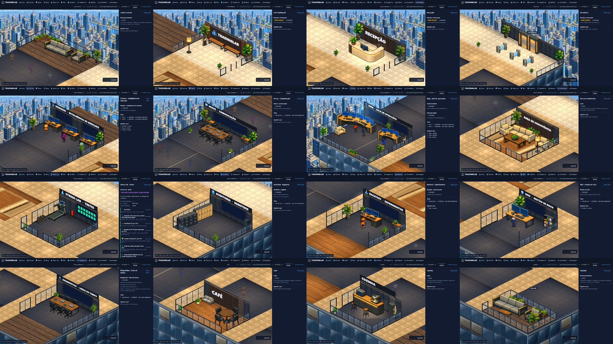

# Escritório 2.0 · planta modular (F8)

A F8 refaz a planta do andar sobre a F7 (PR #100). O cenário continua sendo montado em tempo de execução: **piso, parede, vidro, placa e cada móvel são peças separadas**, em projeção isométrica 2:1 exata, e cada sala continua clicável, com painel e dados reais. Nada aqui lê ou muda estado do backend; telas sem dado seguem apagadas e nenhum agente ou mercado é inventado.

## O que estava errado

- **F7:** a planta de 40×30 tinha salas de tamanhos soltos, corredores de largura irregular, paredes só em parte dos lados e móveis que "boiavam" (muito espaço vazio, vidro quase ausente). Cada sala parecia um bloco solto.
- **Imagem única como cenário (tentativa posterior, só no diretório de trabalho do Codex, nunca commitada):** uma imagem de 1536×1024 desenhada como fundo, com polígonos medidos por cima. Não serve: não é interativa (móvel não é peça), a perspectiva é levemente curva (não é 2:1), e todo ajuste exigiria gerar outra imagem. Ela ficou só como **referência de composição**; nada dela entra no código.

## A planta

Grade de **44×33 tiles** (tile 48×24, origem em 840,112, cena 1920×1056). `i` cresce para baixo-direita e `j` para baixo-esquerda. Os retângulos são semiabertos `[i0,i1) × [j0,j1)`.

| Faixa | Salas |
|---|---|
| Frente do prédio (j 0–6) | Jardim externo (i 0–12), Hall TradingLab (12–21), Recepção (21–30), Elevadores (30–44) |
| Ala da esquerda (i 0–12) | Horizon (j 6–14), Nexus (14–22), Ring (22–33), empilhadas e de frente para V1 |
| Linha 1 (j 10–17) | Convivência (i 15–23), Stress Lab (26–33), Auditoria (36–44) |
| Linha 2 (j 21–28) | Backtest (15–23), Risk (26–33), Diagnóstico (36–44) |
| Linha 3 (j 28–33) | Café (15–23), Cozinha (26–33), Varanda (36–44) |

Corredores: **V1** (i 12–15), **V2** (23–26), **V3** (33–36), **H1** (j 6–10) e **H2** (j 17–21). São faixas retas, sem sala dentro.

## Regras de projeto

Todas são conferidas por `scripts/assets/office2-layout.mjs` (que recusa gravar a planta se alguma falhar) e por `test/office2-planta.test.ts`.

1. **Corredores retos.** Nenhuma sala ocupa as faixas V1, V2, V3, H1 e H2. Salas de uma mesma coluna têm o mesmo `i0` e `i1`; as de uma mesma linha, o mesmo `j0`.
2. **Parede alta só onde há placa ou tela.** A parede de trás (`j0`) de cada sala com tela ou placa é maciça, de 72 px. O que está virado para um corredor é vidro (48 px nas laterais, 30 px na frente) ou guarda-corpo.
3. **Duas fileiras atrás de parede alta ficam livres.** Uma parede de 72 px esconde 24 px de altura por tile de distância; objeto a menos de 3 tiles atrás dela fica quase todo escondido. O autor da planta mede, móvel por móvel, quanto sobraria à vista e recusa o que ficaria quase todo atrás da parede. Por isso o fundo de cada linha de salas tem faixa de piso livre e os corredores têm 3 a 4 tiles.
4. **Cada sala declara as bordas.** `edges` diz o tipo de cada lado; sem tipo, não há parede. Tipos: `parede-painel`, `parede-marca`, `fachada-vidro`, `divisoria-vidro`, `divisoria-vidro-baixa`, `guarda-corpo-vidro`, `divisoria-baixa`, `aberta`.
5. **Portas e circulação.** Cada porta tem um tile livre dentro e outro fora. Todos os postos e pontos de lazer têm rota a partir da chegada, e nenhuma sala fica com menos de 35% do piso livre.
6. **Móveis encostados nas paredes, com a frente para a sala.** Cada peça com frente (sofá, poltrona, mesa de trabalho, arquivo, armário, bancada, geladeira, esteira) declara a parede em que apoia as costas. A arte de todas vem desenhada com a frente para +i e as costas para −i; espelhada, a frente olha para +j. Logo, **parede de fundo direita (`j0`): espelhada, de frente para o sudoeste; parede de fundo esquerda (`i0`): sem espelho, de frente para o sudeste.** A orientação sai da parede, e não do formato do retângulo. Como só existem frentes voltadas para a câmera, peça com frente não vai nas bordas da frente. A folga até a parede é de no máximo 1 tile, e o centro da sala fica livre. Exceções por natureza: tapete, mesa de centro, mesas de reunião e de café, balcão da recepção, catracas, banquetas e a bancada de testes. Cada móvel tem posição e ocupação em tiles, sem sobreposição, sem tapar porta ou posto, e um posto de trabalho fica de frente para a mesa.
7. **Telas só com dado real, e visíveis.** As dez telas ficam na parede `j0`, na faixa de 22 a 70 px de altura, acima dos móveis baixos; nada alto fica na frente de uma tela. Sem dado, ficam apagadas. Sala com tela leva a placa em faixa por cima dela.

## Desenho

- **Paredes:** altura por tipo, rodapé escuro, tampo com fio de luz e juntas por tile; **montantes** escuros em cada ponta livre, canto e batente de porta, com luz âmbar nos batentes de parede alta ou vidro.
- **Vidro:** película azulada, brilho diagonal, montantes pretos, travessa grossa e rodapé; os guarda-corpos têm fio âmbar.
- **Chão:** corredores com tom quente por cima do mármore, sombra suave junto de cada parede alta e luminárias de teto em retículo; poças de luz por sala.
- **Paredes que escondem agentes** ficam translúcidas enquanto escondem (só para agentes; nenhum dado muda).
- **Sala em foco:** os móveis das outras salas não são desenhados (sem "fantasmas" translúcidos); as paredes delas também somem.
- **Fachada:** andares com luz quente de escritório, luz de teto nas vidraças, lajes iluminadas por baixo e vidraças frias; sem silhuetas de gente.
- **Câmera:** a visão geral enquadra a planta (inclusive o alto das placas), o que aumenta o desenho em cerca de 12%. `/office2/#ring` (qualquer id de sala) abre direto na sala.

## Como regenerar

```powershell
node scripts/assets/office2-layout.mjs --mapa   # imprime a planta em texto e valida, sem gravar
node scripts/assets/office2-layout.mjs          # valida e grava public/office2/scene-map.json
```

`--mapa` desenha a planta em texto: letra da sala no canto, `#` móvel, `*` planta, `~` tapete, `D` porta, `A` posto, `o` ponto de lazer, `S` chegada, `:` corredor.

## Conferência







- `test/office2-planta.test.ts`: corredores retos e salas alinhadas, tipos de parede, móveis na parede com a orientação certa, regra das duas fileiras (pelo autor da planta), alturas, montantes e batentes, parede translúcida diante de agente, enquadramento da visão geral e endereço `#sala`.
- As 16 salas foram abertas uma a uma (foco, painel e retorno) em 1920×1080.
